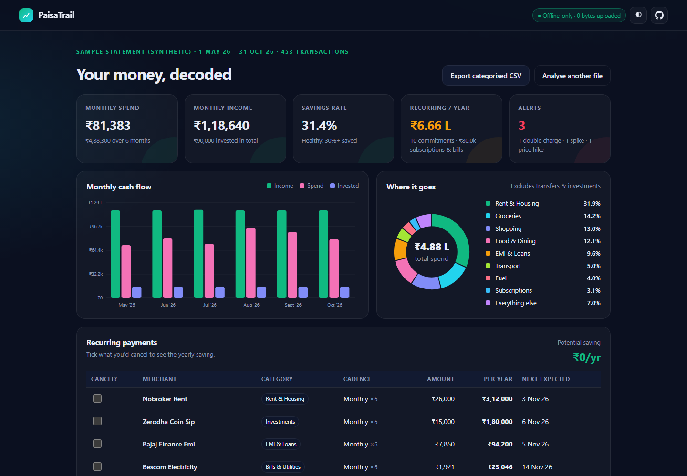

<div align="center">

# PaisaTrail

**Find the money leaks hiding in your bank statement, without uploading it anywhere.**

[](https://github.com/Chickoo123/paisatrail/actions/workflows/ci.yml)
[](https://github.com/Chickoo123/paisatrail/actions/workflows/codeql.yml)


### [▶ Live demo](https://chickoo123.github.io/paisatrail/?demo) · [Use it with your statement](https://chickoo123.github.io/paisatrail/)



</div>

## The problem

Indian bank statements are hard to read. A typical month has 70+ UPI lines like `UPI/612345678901/SWIGGY/swiggy@icici/Payment`, and the costly things hide in that noise: a ₹649 subscription you forgot, a telecom plan that quietly went from ₹599 to ₹699, a food order charged twice.

Budgeting apps solve this by asking for your bank login or uploading your statement to their servers. **PaisaTrail does the whole analysis inside your browser tab.** A strict Content-Security-Policy (`connect-src 'none'`) makes it technically impossible for the page to send your data anywhere.

## What it finds

| Insight | How it works |
|---|---|
| **Recurring payments** (weekly / monthly / quarterly / yearly) | Groups debits by normalised merchant, then checks the median gap against each cadence's tolerance. At least 70% of gaps must be regular and 60% of amounts within ±20%. Projects the next charge date and annual cost. |
| **Silent price hikes** | Flags when the last two charges match each other but differ by more than 2% from the earlier norm. Annual cost is recalculated at the new price. |
| **Double charges** | Same merchant and amount within 2 days, excluding cash and P2P transfers. |
| **Spending spikes** | Robust outlier test using median absolute deviation, compared with the merchant's own history (or the category's when history is short). Requires more than 3.5 MAD *and* at least 2.5× typical, so normal variation isn't flagged. |
| **Cash flow & savings rate** | Monthly income vs spend vs invested. Transfers and investments are kept out of "spend", and refunds reduce the category they belong to. |

Plus a **"what if I cancel these?" calculator**, editable categories that PaisaTrail remembers per merchant (stored only on your device), search and filters, and a categorised CSV export.

## Engineering highlights

- **Messy real-world parsing.** Auto-detects the header row under bank preambles. Handles Indian date formats (`05/11/26`, `5-Nov-2026`, `05 Sept 2026`), lakh grouping (`₹1,23,456.50`), `Dr`/`Cr` suffixes, bracket negatives, and both *Withdrawal/Deposit* and *Amount + Dr/Cr* layouts.
- **UPI/NEFT/ACH/POS narration decoding** into readable merchants, with categorisation across 17 categories. Keywords match whole words only, so `credit` never matches `CRED` and `cola` never matches `Ola`. A unit test guards each of these.
- **Zero dependencies, zero build step.** Native ES modules, hand-rolled SVG charts, about 35 KB of unminified JavaScript. Works offline once loaded.
- **Security by construction.** Every piece of statement text is HTML-escaped before rendering, and the CSP blocks inline scripts and all network access.
- **Tested.** 16 `node:test` suites cover the parsers, detectors and an end-to-end run on a deterministic synthetic statement with planted anomalies. CI runs them on Node 20 and 22, CodeQL scans every push, and GitHub Pages deploys only after tests pass.
- **Accessible & responsive.** Keyboard-operable drop zone, labelled controls, `prefers-color-scheme` and `prefers-reduced-motion` support, and a phone layout with no horizontal scrolling.

## Supported statements

Any CSV with a date column, a narration/description column, and either debit and credit columns or an amount column (optionally with a Dr/Cr column). This covers CSV exports from HDFC, ICICI, SBI, Axis and Kotak. If your bank only gives you PDF or XLS, open it in Excel or Sheets and save it as CSV.

## Run locally

```bash
git clone https://github.com/Chickoo123/paisatrail && cd paisatrail
npm test          # 16 test suites, no install needed (Node 20+)
npm run serve     # or: python -m http.server
```

Or open it in **GitHub Codespaces** (button on the repo page). The dev container is preconfigured.

## Architecture

```
index.html        UI shell + strict CSP
styles.css        design tokens, dark/light themes, responsive grid
src/core.js       pure analysis engine (parse → normalise → categorise → detect)
src/app.js        rendering, SVG charts, interactions, local-only persistence
src/sample.js     deterministic synthetic statement for the demo and tests
tests/            node:test unit and end-to-end tests
```

`core.js` has no DOM access, so the same engine runs in the browser and under Node in CI.

## Roadmap

- [ ] PDF statement parsing with pdf.js (still client-side)
- [ ] Multi-file merge across accounts and credit cards
- [ ] Budget targets per category with month-to-date pacing

---

Built by [Harshil Desai](https://github.com/Chickoo123). Insights are informational and not financial advice. The sample data is synthetic.
